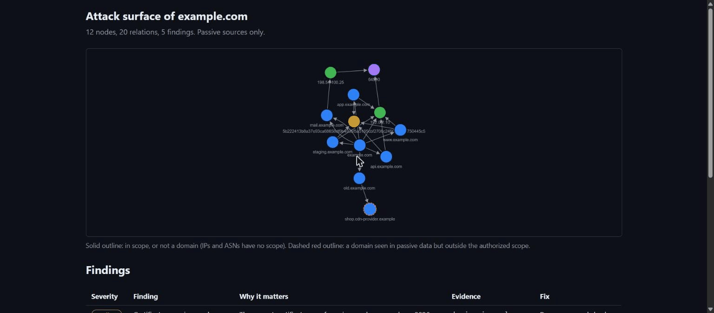
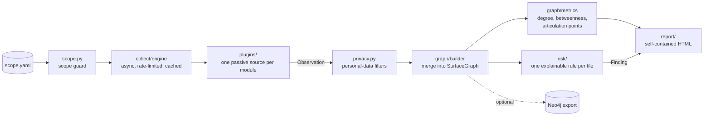

# SurfaceMap

Passive attack-surface mapping of a domain you own or are authorized to assess, rendered as a graph.

> Use only on domains listed in your `scope.yaml` (see [Ethics & legal](#ethics--legal)).

## Quick start

```bash
py -3.11 -m venv .venv                      # Linux/macOS: python3.11 -m venv .venv
.venv/Scripts/python -m pip install -e ".[dev]"
cp scope.example.yaml scope.yaml            # list the domains you are authorized to assess
.venv/Scripts/surfacemap scope check example.com
.venv/Scripts/surfacemap scan example.com -o example.com-report.html
```

The report is a single self-contained HTML file (Cytoscape.js inlined): open it offline.

## Demo



*Illustrative only: a fictional `example.com` surface (documentation IP ranges), not a real scan,
because the only authorized real target has a single host. Regenerate it with
`python media/make_demo_report.py demo.html`.*

## Architecture



Plugins never touch the graph: they return `Observation` objects and only `graph/builder.py`
merges them. Every entry point goes through the scope guard first, and everything a plugin emits
passes through `privacy.py` before entering the graph. Details: [docs/architecture.md](docs/architecture.md).

## Sources and their limits

Passive means third-party public data only; nothing is ever sent to the target.

| Source | Gives | Main limit |
|---|---|---|
| crt.sh (Certificate Transparency) | subdomains, certificates | only names with a logged certificate; wildcards hide hosts; frequent 5xx |
| DNS (system resolver) | A/AAAA, CNAME, MX, NS, TXT, DMARC | resolves known names, does not discover |
| RDAP / WHOIS fallback | registered name servers | contacts discarded; WHOIS only when the TLD has no RDAP |
| Team Cymru, iptoasn (local) | ASN, holder, country | country level; a CDN IP says nothing about the origin |
| Wayback CDX | archived paths | only what the Archive crawled; query strings stripped |
| Shodan (optional, key) | ports/banners already scanned | off without a key; data stays Shodan's |
| Google dorks | links to open by hand | never run automatically |

Coverage is a lower bound: hosts with no certificate, archive entry or reachable DNS name are
invisible. Full table and "what passive cannot see": [docs/sources.md](docs/sources.md).

## Methodology

1. **Scope check**: the domain must be in `scope.yaml`, else the run is refused before any network object exists.
2. **Collect**: an async engine fans out over the plugins, behind one HTTP client (per-source rate limit,
   SQLite cache, redirects never followed, never a request to the target).
3. **Filter**: `privacy.py` strips personal data before anything is cached or merged.
4. **Merge**: observations carry their provenance into one graph, so each claim is traceable to a source.
5. **Analyse**: graph metrics (degree, betweenness, articulation points = single points of dependency) and
   explainable risk rules (`rationale`, `evidence`, `remediation`; takeover is a DNS-only lead).
6. **Evaluate**: compared with Amass and Subfinder (passive) with recall relative to the union of tools and
   failed runs reported as `n/a`. On the one tested domain the surface is a single host, so the benchmark
   does not discriminate: see [docs/evaluation.md](docs/evaluation.md).

More: [docs/methodology.md](docs/methodology.md).

## Ethics & legal

- **Authorization first.** Only map domains you own or hold written permission to assess. In France,
  fraudulently accessing or remaining in an automated data processing system is an offence under
  **Code pénal art. 323-1** (up to three years' imprisonment and a EUR 100,000 fine at the time of
  writing; check [Légifrance](https://www.legifrance.gouv.fr/) for the current text). Probing a
  system you are not authorized to test can fall under it, even with good intentions.
- **Enforced, not just advised.** `scope.yaml` lists authorized domains with an optional expiry;
  every entry point goes through `scope.py`, and an out-of-scope domain is refused before any
  network object is created.
- **Passive by construction.** No port scan, no bruteforce, no HTTP request to the target or its
  subdomains (the HTTP client raises `PassiveViolationError`). Out-of-scope names met on the way, such
  as a CDN CNAME target, are recorded and DNS-resolved, never enriched.
- **No personal data.** Registrant contacts, emails and individual names are filtered out before the
  cache and the graph (`privacy.py`).
- **Third-party terms.** Shodan data stays Shodan's (credit it, respect your plan); Google dorks are
  generated as links and never run automatically; crt.sh, Team Cymru and WHOIS servers are rate-limited.
- **Findings are leads.** A takeover finding is inferred from DNS only; verify and report responsibly
  to the domain owner. This section is engineering context, not legal advice.

## Improvement ideas

Each one answers a limit documented above.

- **A meaningful benchmark**: a domain with dozens of subdomains and logged certificates, several runs
  per tool and a median, to replace the single-host run in [docs/evaluation.md](docs/evaluation.md).
- **Keyed sources**: Censys, SecurityTrails or VirusTotal behind the same plugin contract, and a
  keyed Subfinder/Amass baseline for a fairer comparison.
- **Record which plugin saw each node** in every run (partly done for the benchmark) to explain
  differences between tools instead of hypothesising.
- **crt.sh resilience**: retry with backoff, fall back to a second CT search, and surface "source
  degraded" in the report.
- **Diff between scans**: store graphs over time and highlight new or vanished hosts, the useful
  signal for continuous monitoring.
- **More risk rules**: dangling NS delegations, expiring certificates across a whole estate, CAA
  records, MTA-STS/TLS-RPT.
- **Optional active mode, strictly opt-in**: confirming a takeover with one request would help, but it
  breaks the passive invariant, so it would need an explicit scope flag and its own legal review.
