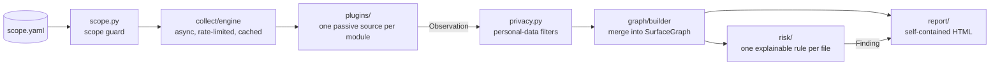

# Architecture

One scan = `scope check` → collect → merge → analyse → render. Each stage is a separate module so it
can be tested offline (network fully mocked with respx, recorded fixtures).

Graph metrics (`graph/metrics.py`) and the Neo4j export are library modules, not wired into `domain-mapper scan` yet.

## Design decisions

- **Scope first.** `Scope.require()` runs before the cache, the HTTP client or any plugin exists.
  A domain not in `scope.yaml` (or past its expiry) is refused with exit code 1.
- **Plugins are pure producers.** A plugin returns `Observation`s; the builder merges them. A
  plugin declares whether it may run on out-of-scope names (`runs_out_of_scope`): only DNS
  resolution does. Out-of-scope nodes (for example a CNAME target on a CDN) are recorded and
  resolved, never enriched.
- **Privacy at the boundary.** Registration data and banners are reduced by `privacy.py` *before*
  the response cache, so personal data is never stored.
- **Risk rules are explainable.** One rule per file, each finding carries `rationale`, `evidence`
  and `remediation`. A crashing rule aborts the run (`RuleError`): a silently skipped rule would
  read as "no risk found".
- **Reproducible.** Rules are pure functions of the graph and a pinned date.
